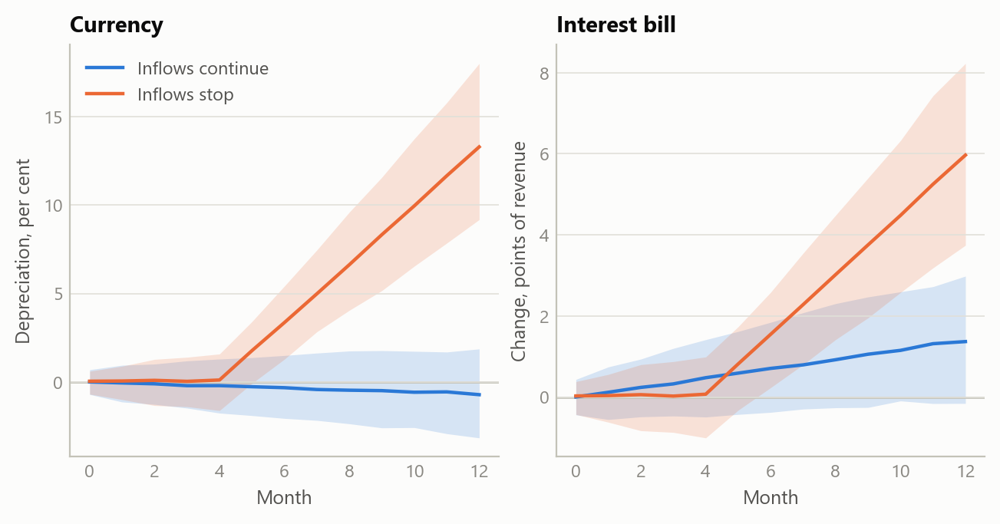

# Who holds the debt, and in what currency: an Egypt country debrief
Carlos Galindo

> [!NOTE]
>
> ### At a glance
>
> - **Question.** Where does funding stress land in an economy whose government owes part of its debt in foreign currency and relies on non-resident holders of its local bills, and what follows for policy, the public finances and market positions?
> - **Approach.** The funding-regime projection framework run as a full country debrief: the regime test, the macroeconomic position, transmission from policy to market prices, scenarios with falsifiers and a watch-list.
> - **Finding.** The regime test put Egypt on the foreign-currency path: foreign holders of local bills make local debt behave like foreign debt for the currency. High real rates hold the pound and pull inflation down while they raise the interest bill. The currency support lasts only while inflows continue; the interest cost does not, and it rises if they stop.
> - **Why it matters.** The sign of a high-real-rate policy depends on a flow that can stop. The debrief names the releases that would show it turning, with the end of the IMF programme as the clearest dated test.

## The question

Original sin, and its local-currency form when foreign investors hold the local bonds, made the currency of the debt and its holder base the standard lens on where sovereign funding stress lands. The framework builds that lens into one calibrated quarterly projection model as an explicit switch: the debt structure decides whether a funding shock lands on the exchange rate or on long-dated government bond yields.

Its five-economy application ran on the local-currency side (see the note on a funding-shock projection model). Egypt runs on the other side: material external public debt, a large share of local bills held by non-residents, heavy external repayments, and the end of an IMF programme in view. The author covered Egypt in co-authored sell-side research in 2017.

## Approach

**The evidence chooses the regime.** The model tests the debt structure before it assigns a block. For Egypt the test returned the foreign-currency path: material external public debt, a large share of local bills held by non-residents, and repayments falling due within the year. On that path reserve cover, external repayments and the rollover of non-resident bills carry the risk that the long-end auction carries in an advanced economy.

**Fiscal measures traced to the curve and the currency.** The debrief reads labour and product markets, inflation, monetary and fiscal policy, public debt management and external flows in one model. It traces a fiscal measure from announcement and legal status through financing, demand, wages and prices to the central bank, the bond curve and the currency, and back to the budget, and it stops the chain at the first link the evidence cannot support.

## What the work shows

**Where the carry reading turns.** The familiar reading of Egypt is a carry trade financing a heavy interest bill. The debrief makes its turning point explicit. A policy rate well above inflation draws foreign money into local bills, supports the currency, and keeps import prices, and so inflation, on a downward path. The same rate raises the share of government revenue spent on interest, which strains the fiscal credibility on which the inflows depend. While inflows continue, the first effect dominates. If they stop, the sign flips: the currency weakens, pass-through raises prices, and policy is pushed to tighten into a heavier interest bill, the fiscal-dominance trap that short, foreign-held debt sets for a high-real-rate policy. The figure shows the shape of that fork on simulated data.

Figure 1: One high-real-rate regime under two paths for foreign inflows: median and 90% band of the currency and of the public interest bill over twelve months (simulated data).

**Scenarios are tied to a test.** The debrief set out a base case, an upside and a tail, each starting from a different event and each carrying a falsifier: a named release and the level at which it would show the scenario to be wrong. The end of the IMF programme is the clearest dated test of whether the inflows, and so the favourable side of the fork, hold.

**Follow-up questions.** Three narrower questions ran on the same country: external-debt sustainability, the politics of official financing as the IMF programme ends, and a disruption to imported food. Each traced back into the same loop between real rates, foreign inflows and the interest bill. Politics enters through the official inflows that keep the rollover going and through the anchor that the programme’s end removes. The food shock tightens the loop at the margin without becoming the trigger.

## Insights

1.  **The holder matters as much as the currency.** Local bills held by foreign investors tie the currency to the same flow that finances the budget, so the regime test reads who holds the debt as well as its denomination.
2.  **The same instrument can support and threaten.** A high real interest rate can buy disinflation and a stable currency while raising the fiscal cost that sustains them. Which effect dominates depends on a flow, foreign inflows, that can stop.
3.  **A shock that tightens is not a shock that breaks.** A dearer import bill can keep interest rates higher for longer and the public interest bill heavier, but the path flips only if financing stops. Keeping the two apart stops a briefing from reading every new headline as a crisis.

## Scope and next steps

The framework reads an emerging market on the foreign-currency path and advanced economies on the local-currency path with one calibrated model, and delivers a country debrief with scenarios, falsifiers and, on request, market positions.

The natural extensions are three. First, the debrief’s figures set out at their official sources: the gross external financing need against reserves and committed official inflows, and non-resident bill holdings against the interest bill. Second, the specification applied across the Middle East and North Africa and to hybrid cases where both debt blocks run at once. Third, a policy version of the output, in which the fiscal transmission map is read for its implications for official lending, programme design and spillovers to the UK.

The full specification, the country briefing and its plain-language versions can be discussed on request.

## About the evidence

The work was done in October 2026. It rests on the written model specification, a full country briefing on Egypt with its scenarios, watch-list and trade ideas, a short research abstract, plain-language explanations for non-specialists, and three follow-up assessments (external-debt sustainability, the politics of official financing, and a supply shock to imported food). Every figure in the briefing is graded as established from a named official source, inferred with its method stated, or not identified, and conflicting sources are shown side by side. The coefficients are calibration priors, not estimates. The market and fiscal figures behind the briefing are not reproduced here. The figure is simulated, built to share the structure of the analysis (a two-path fork for foreign inflows); it shows no real estimate.

Figures and tables marked *simulated* are generated from simulated data built to share the structure of the analysis (its variables, horizons and frequencies). They show how each method works and what its output looks like. Results stated in the text, and figures that give a source, are the project’s own. Methods are described at the level of a methods section. Code and data pipelines are not reproduced here.
