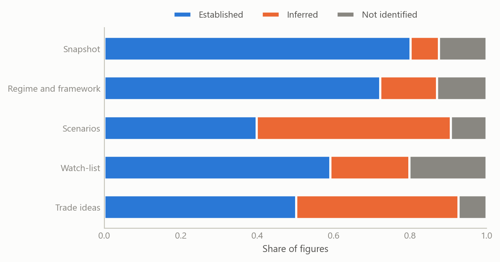

# An emerging-market briefing in days, from a model that knows when not to trade
Carlos Galindo

> [!NOTE]
>
> ### At a glance
>
> - **Question.** Can a framework built and tested on advanced economies brief an emerging market with foreign-currency debt at short notice, without cutting corners on the evidence?
> - **Approach.** The same calibrated projection model and the same evidence standard, applied to Egypt within days. The evidence chose the regime, and the briefing ran from the country’s macroeconomic position to scenarios, a watch-list and, on request, trade ideas.
> - **Finding.** The framework placed Egypt on the foreign-currency path and brought out the two-sided effect of high real interest rates: they support the currency and pull inflation down, and they raise the public interest bill. Both effects last only while foreign inflows continue.
> - **Why it matters.** Speed and rigour usually trade off. Here the speed comes from the framework itself, and the rigour comes from a standard that marks every gap in the evidence and declines to recommend anything the evidence cannot carry.

## The question

A country briefing written at short notice tends to fail in one of two ways. It is either thin, because there was no time to build a view, or confident beyond its evidence, because the gaps were filled with plausible numbers. Emerging markets make both failures more likely. The data are released with longer lags, the official and market sources disagree more often, and the price that can break is not always the one an advanced-economy reader expects to watch.

The framework had been built to read advanced and emerging economies with one model, letting the currency in which public and bank debt is owed decide where a funding shock lands. Its first application covered five advanced economies, all of which borrow in their own currency. The open test was the other side of the fork: an economy whose government owes a large part of its debt in foreign currency, relies on foreign holders of its local bills, and sits close to the end of an IMF programme. Egypt fits that description, and the author last covered it in co-authored sell-side research in 2017. The question was whether the framework could carry a full briefing on it within days.

## Approach

**The evidence chooses the regime.** The model does not assume that a country is an emerging market. It tests the debt structure first, in a fixed order, and the first test the evidence passes decides which block of the model applies. For Egypt the evidence pointed to the foreign-currency path: material external public debt, a large share of local bills held by non-residents, and repayments falling due within the year. On that path the objects to watch are reserve cover, external repayments and the willingness of foreign investors to keep rolling their bills, rather than the long-end auction that dominates an advanced economy’s reading.

**One standard for every figure.** Every number in the briefing carries a grade: established from a named official source, inferred with its method stated, or not identified. Official producers come first: the central bank, the statistics office and the finance ministry, with international institutions and rating agencies as confirmation. Where two sources disagreed, both were set side by side and the one used was named. Where a series was not published for Egypt, the briefing said so and set no trigger on it.

**Trade ideas are optional and conditional.** The same framework that writes the briefing can, on request, turn it into market positions. Each position must be tied to a mechanism in the briefing, carry an exit condition stated as an observable event, and be sized from a stated risk budget. Where the evidence for any of these is missing, the output is not a weaker trade but no trade, with the missing inputs named.

**One evidence base, several readers.** From the same graded evidence the framework produced a desk-style briefing, a short research abstract and plain-language explanations for readers without an economics background. The figures and their grades are identical across all three; only the register changes.

## What the work shows

**The regime fork works on the other side.** The model that read five advanced economies on the local-currency path read Egypt on the foreign-currency path, using the same equations. The difference sits where the economics puts it: in which stock can break, and therefore in which prices and releases deserve attention.

**High real rates cut both ways.** The central finding of the briefing is a mechanism, not a forecast. A policy rate well above inflation draws foreign money into local bills, supports the currency, and keeps import prices, and so inflation, on a downward path. The same rate raises the share of government revenue spent on interest, which strains the fiscal credibility on which the inflows depend. While inflows continue, the first effect dominates. If they stop, the sign flips: the currency weakens, pass-through raises prices, and policy is pushed to tighten into a heavier interest bill. The first figure shows the shape of that fork on simulated data.

Figure 1: One high-real-rate regime under two paths for foreign inflows: median and 90% band of the currency and of the public interest bill over twelve months (simulated data).

**Scenarios are tied to a test.** The briefing set out three scenarios, a base case, an upside and a tail, each starting from a different event and each carrying a falsifier: a named release and the level at which it would show the scenario to be wrong. The end of the IMF programme stood out as the clearest dated test of whether the inflows, and so the favourable side of the fork, would hold.

**The gaps are part of the output.** A briefing that marks what it could not find is more useful than one that hides it, because the gap tells the reader where the risk of being surprised is largest. The second figure shows, on simulated data, the kind of evidence ledger the standard produces: the share of figures in each part of a briefing that are established, inferred or not identified. The later, more judgemental parts carry more inference by design, and trade ideas are issued only where their evidence conditions are met.

Figure 2: Evidence ledger of a country briefing: share of figures established, inferred or not identified, by part of the briefing (simulated data).

**The framework grew from the exercise.** Applying it to an emerging market under time pressure showed where it was thin, and the specification was then broadened to cover labour markets, supply capacity, aggregate demand, fiscal policy and public debt management in one integrated reading. Fiscal decisions are now traced step by step, from announcement and legal status through financing, demand, wages and prices, to the central bank, the bond curve and the currency, and back to the budget, with the chain stopping at the first link the evidence cannot support.

**Follow-up questions run on the same standard.** The framework then answered three narrower questions on the same country: whether it can keep servicing its foreign debt, how the politics of official financing enter that answer as its IMF programme ends, and whether a disruption to imported food changes it. Each answer was traced back into the same loop between real rates, foreign inflows and the interest bill, and each stopped where the evidence stopped. The foreign debt is manageable on its present path only while maturing obligations keep being rolled over and the currency holds. Politics matters through the official inflows that keep that rollover going and through the anchor that the programme’s end removes. The food shock tightens the loop at the margin without becoming the trigger.

## Insights

1.  **Speed comes from the framework, not from shortcuts.** A model that already knows which questions decide a country’s risk turns days of preparation into a briefing that can be read and challenged line by line.
2.  **The same instrument can support and threaten.** A high real interest rate can buy disinflation and a stable currency while raising the fiscal cost that sustains them. Which effect dominates depends on a flow, foreign inflows, that can stop.
3.  **Knowing when not to trade is a feature.** A recommendation that cannot name its exit, its size and its evidence is withheld, with the missing inputs listed. That discipline is what makes the recommendations that are issued worth reading.
4.  **A marked gap is information.** The places where the evidence is not identified are where the next release can surprise most, and the briefing says so instead of filling them.
5.  **One evidence base can serve every reader.** Graded evidence can be written up for a trading desk, a policy reader or a non-specialist without the numbers changing between versions.
6.  **A shock that tightens is not a shock that breaks.** A dearer import bill can keep interest rates higher for longer and the public interest bill heavier, but the path flips only if financing stops. Keeping the two apart stops a briefing from reading every new headline as a crisis.

## Scope and next steps

The framework reads an emerging market with foreign-currency debt and an advanced economy with local-currency debt on one calibrated model, and can deliver a graded country briefing at short notice, with market positions available on request and withheld where the evidence is short.

The natural extensions are three. First, the broadened specification, with its labour, supply and fiscal blocks, applied across the Middle East and North Africa and to hybrid cases where both debt blocks run at once. Second, the briefing tracked through time, so that each scenario’s falsifier is checked against the release that tests it. Third, a policy version of the output, in which the fiscal transmission map is read for its implications for official lending, programme design and spillovers to the UK.

The full specification, the country briefing and its plain-language versions can be discussed on request.

## About the evidence

The work was done in October 2026. It rests on the written model specification, a full country briefing on Egypt with its scenarios, watch-list and trade ideas, a short research abstract, a plain-language explanation for non-specialists, the broadened specification written after the exercise, and three follow-up assessments (external-debt sustainability, the politics of official financing, and a supply shock to imported food), two of them with plain-language versions. The coefficients are calibration priors, not estimates. The market and fiscal figures behind the briefing are not reproduced here. The two figures are simulated, built to share the structure of the analysis (a two-path fork for foreign inflows, an evidence ledger by part of the briefing); neither shows a real estimate.

Figures and tables marked *simulated* are generated from simulated data built to share the structure of the analysis (its variables, horizons and frequencies). They show how each method works and what its output looks like. Results stated in the text, and figures that give a source, are the project’s own. Methods are described at the level of a methods section. Code and data pipelines are not reproduced here.
